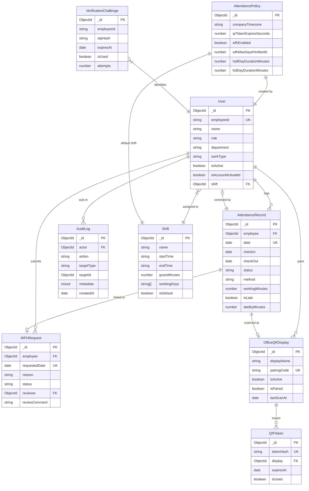

# VORLDX EMPLOYEE ATTENDANCE SYSTEM
## Project Report
**Organization:** VORLDX INDUSTRIES PRIVATE LIMITED  
**Project Type:** Full Stack Web Application (Internship Project)  
**Technology:** MERN Stack (MongoDB, Express.js, React, Node.js)  
**Date:** October 2026  
**Document Version:** 1.0.0  

---

## 1. Introduction & Objectives

### 1.1 Organizational Context
**VorldX Industries Private Limited** operates across multiple engineering, marketing, and operational divisions with a modern, hybrid workforce. Efficient management of human capital requires an accurate, frictionless, and tamper-resistant mechanism for logging employee work hours, managing on-site vs. remote उपस्थिति (attendance), and maintaining rigorous audit trails for HR compliance.

### 1.2 Problem Statement
Traditional workplace attendance mechanisms present significant operational challenges:
* **Manual Logbooks & Biometrics:** Prone to clerical errors, proxy punching, hardware degradation, hygiene concerns, and high installation costs across secondary branch offices.
* **Static QR Codes:** Highly vulnerable to screenshot copying, where employees off-site can easily scan a shared image and falsely register on-site presence.
* **Siloed Remote Work:** Lack of real-time synchronization between Work From Home (WFH) approvals and on-site attendance logs, leading to payroll discrepancy and administrative overhead.
* **Unclear Audit Accountability:** Changes made to attendance records by supervisors often lack historical traceability, leaving disputes unresolved.

### 1.3 Project Objectives
The VorldX Employee Attendance System was engineered to achieve the following core objectives:
1. **Dynamic Ephemeral QR Attendance:** Provide an on-premise tablet/kiosk display generating rolling, single-use, 30-second cryptographic QR tokens that prevent screenshot-sharing and remote proxy check-ins.
2. **Integrated Hybrid Workforce Management:** Seamlessly handle office, hybrid, and remote employees with automated WFH quota tracking, eligibility checks, and administrative approval workflows.
3. **Automated Policy & Shift Calculations:** Dynamically evaluate check-in times against shift definitions and grace intervals to calculate late arrivals, working minutes, and incomplete shifts without manual HR intervention.
4. **Administrative Visibility & Governance:** Empower HR personnel with a centralized operational dashboard, department-level distribution metrics, 7-day attendance trends, manual correction workflows with audit accountability, and CSV data export.
5. **Zero-Trust Security & Audit Immutability:** Enforce role-based access control (RBAC), rate-limiting, bcrypt credential hashing, and append-only audit logging across all critical state changes.

---

## 2. Scope of the Project

### 2.1 In-Scope Capabilities
* **User Authentication & First-Time Activation:** Secure employee onboarding via temporary one-time password (OTP) verification and credential setup.
* **Dynamic Kiosk Display System:** Dedicated browser-based kiosk route displaying rotating QR codes with auto-refresh intervals and visual countdown indicators.
* **Attendance Processing Engine:** Multi-stage evaluation of scan tokens, preventing duplicate check-ins, tracking check-out timestamps, and computing working hours.
* **Work From Home (WFH) Pipeline:** Multi-tier request submission, policy eligibility enforcement, manager review interface, and automatic attendance record synchronization.
* **HR Administration Suite:** Employee directory CRUD operations, organizational attendance filtering, manual attendance corrections with rationale logging, policy configuration, and display terminal provisioning.
* **Audit Trail System:** Automated recording of authentication attempts, administrative updates, scans, and security violations.
* **Reporting & Analytics:** Aggregated metrics, trend charts, and structured CSV export generation.

### 2.2 Out-of-Scope Capabilities
* **Payroll Processing:** Salary calculations, tax deductions, bonuses, and direct bank disbursement (designed for integration via CSV export).
* **Comprehensive Leave Management:** Tracking paid vacation, sick leave, maternity/paternity leave, or compensatory offs.
* **Hardware Biometrics:** Fingerprint, facial recognition hardware, or RFID card scanners.
* **Physical Hardware Provisioning:** Custom micro-controller firmware or dedicated POS hardware.

---

## 3. Implemented Features

### 3.1 HR Admin Features
* **Executive Metrics Dashboard:** Real-time visibility into total headcount, active employees present, late arrivals, remote staff, pending WFH requests, and overall attendance percentage.
* **Departmental Distribution Analytics:** Aggregation and graphical representation of attendance breakdown across Engineering, Marketing, Finance, and Human Resources.
* **Historical Trend Charts:** 7-day rolling attendance line chart plotting present, late, WFH, and absent numbers.
* **Employee Directory Control:** Paginated tabular view with instant search, department filters, and modal forms for adding new employees or updating work classifications (Office, Hybrid, Remote).
* **Account Activation/Deactivation:** Immediate kill-switch to deactivate departed or suspended employees, instantly invalidating active sessions.
* **Attendance Record Correction:** Administrative override form allowing HR to correct missed check-outs or incorrect statuses. Requires a mandatory rationale (minimum 10 characters) and saves previous values into an immutable audit snapshot.
* **WFH Queue Management:** Decision modal allowing admins to approve or reject remote work requests with contextual comments.
* **Policy Customization:** UI controls to adjust company timezone, QR token lifespan, default shift assignment, monthly WFH allowances, and advance notice constraints.
* **Display Terminal Pairing:** Administrative interface to register new office entrance terminals and assign pairing codes.
* **Audit Trail Inspection:** Filterable log viewer displaying actor, action type, target entity, timestamp, IP address, and metadata diffs.

### 3.2 Employee Features
* **Modern Employee Portal:** Personalized home screen displaying assigned shift hours, current attendance status, real-time working duration counter, and quick action cards.
* **Integrated QR Scanner:** Camera-enabled QR scanner powered by `html5-qrcode` with support for camera switching, video feed pausing, and fallback manual token testing.
* **Attendance History Log:** Personal chronological attendance log displaying check-in/out timestamps, calculated duration, late markers, and administrative correction notes.
* **Self-Service WFH Desk:** Interactive date picker that queries the backend eligibility API in real time, displays remaining monthly allowance, and submits requests with detailed business justification.
* **Profile Management:** Overview of employment details, assigned shift schedules, grace periods, and work type settings.

### 3.3 Dynamic QR & Display Terminal Features
* **Auto-Rotating Kiosk Display:** Standalone route designed for full-screen lobby mounting. Fetches fresh tokens every 30 seconds via secure polling.
* **Synchronized Visual Countdown:** Circular SVG progress timer showing remaining token lifespan.
* **Cryptographic Token Verification:** Tokens are generated as 32-byte cryptographic random hex strings, hashed using SHA-256 before storage, and verified in constant time.
* **Single-Use Enforcement:** Tokens are atomically flagged as `isUsed: true` on scan, preventing replay attacks.

---

## 4. System Architecture

The VorldX Attendance System follows a decoupled, three-tier Client-Server-Database architecture built on the MERN stack.

```
+---------------------------------------------------------------------------------------+
|                                    CLIENT TIER                                        |
|   React 18 + Vite SPA | Tailwind CSS | React Router 6 | Axios | html5-qrcode         |
|                                                                                       |
|   +-----------------------+   +------------------------+   +----------------------+   |
|   |   Employee Portal     |   |   Admin Dashboard      |   |   Office QR Kiosk    |   |
|   |  - Mobile Scanner     |   |  - Employee CRUD       |   |  - 30s Auto Refresh  |   |
|   |  - Attendance History |   |  - WFH Review Queue    |   |  - Circular Timer    |   |
|   |  - WFH Application    |   |  - Policy & Audit Logs |   |  - Fullscreen UI     |   |
|   +-----------+-----------+   +-----------+------------+   +----------+-----------+   |
+---------------|---------------------------|---------------------------|---------------+
                |                           |                           |
                | HTTPS / REST              | HTTPS / REST              | HTTPS / REST
                | JWT in Bearer / Cookie    | JWT in Bearer / Cookie    | Token Polling
                v                           v                           v
+---------------------------------------------------------------------------------------+
|                                   BACKEND TIER                                        |
|   Node.js + Express.js API | Modular Layered Architecture (MVC + Service Layer)       |
|                                                                                       |
|   +-------------------------------------------------------------------------------+   |
|   | Middleware Pipeline: Helmet | CORS | RateLimiter | Authenticate | Authorize   |   |
|   +-------------------------------------------------------------------------------+   |
|   | Route Controllers:                                                            |   |
|   |  - AuthController       - EmployeeController    - AttendanceController        |   |
|   |  - WFHController        - PolicyController      - QRDisplayController         |   |
|   |  - DashboardController  - ReportsController     - AuditLogController          |   |
|   +-------------------------------------------------------------------------------+   |
|   | Service Layer:                                                                |   |
|   |  - attendanceService    - wfhService    - qrDisplayService    - auditService  |   |
|   +-------------------------------------------------------------------------------+   |
+-------------------------------------------|-------------------------------------------+
                                            |
                                            | Mongoose ODM (Queries & Aggregations)
                                            v
+---------------------------------------------------------------------------------------+
|                                   DATABASE TIER                                       |
|   MongoDB Community Server 6.0+ | Document Store                                     |
|                                                                                       |
|   +-------------------+  +-------------------+  +-------------------+                 |
|   | Users             |  | Shifts            |  | AttendancePolicies|                 |
|   +-------------------+  +-------------------+  +-------------------+                 |
|   | AttendanceRecords |  | WFHRequests       |  | OfficeQRDisplays  |                 |
|   +-------------------+  +-------------------+  +-------------------+                 |
|   | QRTokens (TTL)    |  | Verif. Challenges |  | AuditLogs         |                 |
|   +-------------------+  +-------------------+  +-------------------+                 |
+---------------------------------------------------------------------------------------+
```

### 4.1 Frontend Architecture
* **Component-Based Hierarchy:** Structured into reusable UI primitives (`Button`, `Card`, `Modal`, `Input`, `Table`, `Badge`, `StatsCard`), compound feature components, and lazy-loaded page modules.
* **Context State Management:** Centralized `AuthContext` provides authentication status, active user metadata, token lifecycle, and role validation across all routes.
* **Defensive Route Guards:** Custom `ProtectedRoute`, `AdminRoute`, and `EmployeeRoute` wrappers guarantee that unauthorized roles cannot view protected DOM elements.
* **Timezone Consistency:** Built-in date utilities format timestamps according to company standard timezone (`Asia/Kolkata`) regardless of client browser local time.

### 4.2 Backend Architecture
* **Strict MVC Separation:** Routes handle URL mapping, Controllers manage HTTP request/response lifecycles, and Services encapsulate pure domain business logic.
* **Centralized Error Handling:** Custom `AppError` operational exception class coupled with a global Express error handler middleware that catches asynchronous errors cleanly via `catchAsync`.
* **Rate Limiting Middleware:** Granular rate-limiters applied to sensitive endpoints: login limits (5 requests / 15 min), OTP verification limits (10 requests / 15 min), and QR scan limits (30 requests / min).

### 4.3 Database Architecture
* **Document Modeling:** Schema validation via Mongoose schemas with strict types, custom validators, pre-save normalization hooks, and custom instance methods.
* **Optimized Indexing:** Targeted indexes on query-heavy fields (`employeeId`, `date`, `status`, `department`).
* **Compound Unique Constraints:** Enforced uniqueness on `{ employee: 1, date: 1 }` in `AttendanceRecord` and `{ employee: 1, requestedDate: 1 }` in `WFHRequest`.
* **Time-to-Live (TTL) Indexes:** Automated document expiration on ephemeral security entities (`QRToken` and `VerificationChallenge`).

---

## 5. Database Entities & Relationships

The database schema is comprised of nine core collections modeled with Mongoose:



### 5.1 Model Summaries
1. **User:** Central identity entity. Stores employee ID, hashed password (hidden by default), administrative role, department, designation, employment type (`office`, `hybrid`, `remote`), and account activation flags.
2. **Shift:** Working schedules defining expected start time (`09:00`), end time (`18:00`), grace allowance in minutes (`15`), and recognized working days (`monday`-`friday`).
3. **AttendancePolicy:** Singleton configuration document specifying organizational rules: company timezone (`Asia/Kolkata`), QR rotation duration, monthly WFH allowances, required advance notice days, and workday duration cutoffs.
4. **AttendanceRecord:** Daily attendance sessions. Contains check-in and check-out timestamps, computed duration, status classification, late calculations, and correction audit histories. Enforces a compound unique index on `{ employee, date }`.
5. **WFHRequest:** Employee remote work submissions. Tracks target date, reason, approval status (`pending`, `approved`, `rejected`), reviewer notes, and linked attendance sessions. Enforces a compound unique index on `{ employee, requestedDate }`.
6. **OfficeQRDisplay:** Registered lobby kiosk terminals. Maintains pairing codes, hardware location, active status, and heartbeat timestamps.
7. **QRToken:** Ephemeral tokens generated for kiosk display. Stores a SHA-256 hash of the raw token, expiry timestamp, and usage flag. Has a MongoDB TTL index for automatic deletion.
8. **AuditLog:** Immutable audit ledger storing actor IDs, action categorizations, target identifiers, IP addresses, user agents, and structured metadata diffs.
9. **VerificationChallenge:** Temporary challenges generated during employee first-time activation. Holds hashed 6-digit OTPs, expiry timestamps, and retry attempt counters.

---

## 6. Demo Verification Flow

The VorldX system implements an account activation pipeline that verifies an employee's organizational identity before allowing password creation.

```
+---------------+              +-----------------+              +--------------------+              +-------------------+
|   Employee    |              | Frontend Client |              | Backend Controller |              | Database (Mongo)  |
+-------+-------+              +--------+--------+              +---------+----------+              +---------+---------+
        |                               |                                 |                                   |
        | 1. Enter Employee ID          |                                 |                                   |
        +------------------------------>| 2. POST /auth/start-verification|                                   |
        |                               +-------------------------------->| 3. Query User by ID               |
        |                               |                                 +---------------------------------->|
        |                               |                                 |<----------------------------------+
        |                               |                                 |    (User found, active, not activated)
        |                               |                                 | 4. Generate 6-digit OTP           |
        |                               |                                 | 5. Hash OTP with bcrypt           |
        |                               |                                 | 6. Save VerificationChallenge     |
        |                               |                                 +---------------------------------->|
        |                               | 7. Return { demoOTP, ... }      |                                   |
        |                               |<--------------------------------+                                   |
        | 8. Display OTP in Yellow Box  |                                 |                                   |
        |<------------------------------+                                 |                                   |
        |                               |                                 |                                   |
        | 9. Submit OTP                 |                                 |                                   |
        +------------------------------>| 10. POST /auth/verify-demo-otp  |                                   |
        |                               +-------------------------------->| 11. Compare hash & check attempts |
        |                               | 12. Return { verified: true }   |<----------------------------------+
        |<------------------------------+                                 |                                   |
        |                               |                                 |                                   |
        | 13. Submit Permanent Password |                                 |                                   |
        +------------------------------>| 14. POST /auth/activate-account |                                   |
        |                               +-------------------------------->| 15. Hash password (bcrypt 12)     |
        |                               |                                 | 16. Mark account activated        |
        |                               |                                 | 17. Consume OTP challenge         |
        |                               |                                 | 18. Issue JWT & Set Cookie        |
        |                               | 19. Set Session & Auth Token    |<----------------------------------+
        |<------------------------------+                                 |                                   |
        | 20. Redirect to Dashboard     |                                 |                                   |
```

### Detailed Step Breakdown
1. **Identification:** The employee submits their organizational ID (`EMP003`) at `/verify`.
2. **Account Validation:** The server confirms the employee exists in the database, is currently `isActive: true`, and has not previously completed account activation (`isAccountActivated: false`).
3. **Challenge Generation:** Any lingering unconsumed challenges for this employee ID are deleted. A cryptographically random 6-digit integer is generated, salted and hashed via `bcrypt`, and stored in `VerificationChallenge` with a 5-minute lifespan.
4. **Sandbox Visibility (Demo Mode):** Because `DEMO_MODE=true` is enabled, the plaintext OTP is returned in the API response payload, allowing the client to display it directly inside a prominent yellow guidance banner on screen.
5. **Interim Verification:** The employee inputs the OTP. The server verifies the code against the bcrypt hash without consuming it (`markUsed = false`), validating the attempt count (maximum 3 attempts).
6. **Password Finalization & Activation:** The employee submits their chosen password. The server validates password strength, consumes the challenge (`isUsed: true`), hashes the permanent password with 12 rounds of bcrypt, updates `isAccountActivated = true`, records an `ACCOUNT_ACTIVATED` audit log, and issues a JWT session token.

---

## 7. QR Attendance Flow

The on-site attendance check-in/check-out workflow relies on rolling dynamic tokens displayed on an office kiosk terminal.

```
+------------------+         +-------------------+         +--------------------+         +-------------------+
| Office Kiosk     |         | Mobile Scanner    |         | Backend Controller |         | Database / Models |
+--------+---------+         +---------+---------+         +---------+----------+         +---------+---------+
         |                             |                             |                             |
         | 1. GET /qr-displays/:id/token                             |                             |
         +---------------------------------------------------------->| 2. Invalidate old tokens    |
         |                             |                             | 3. Create 32-byte raw token |
         |                             |                             | 4. Store SHA-256 tokenHash  |
         | 5. Return rawToken & SVG    |                             +---------------------------->|
         |<----------------------------------------------------------+                             |
         |                             |                             |                             |
         | 6. Display Rolling QR       |                             |                             |
         |    (30s countdown)          |                             |                             |
         |                             |                             |                             |
         |                             | 7. Employee scans QR code   |                             |
         |                             +---------------------------->|                             |
         |                             | 8. POST /attendance/scan-qr |                             |
         |                             |    { token: rawToken }      |                             |
         |                             +---------------------------->| 9. Validate token hash & TTL|
         |                             |                             +---------------------------->|
         |                             |                             | 10. Check today WFH status  |
         |                             |                             | 11. Determine Check-In/Out  |
         |                             |                             | 12. Evaluate Late Arrival   |
         |                             |                             | 13. Upsert AttendanceRecord |
         |                             |                             | 14. Flag token as isUsed    |
         |                             | 15. Return status & record  |<----------------------------+
         |                             |<----------------------------+                             |
         |                             |                             |                             |
         |                             | 16. Show visual check-in/out|                             |
```

### Security & Operational Considerations
* **Replay Attack Resistance:** If an employee photographs the QR display and messages the image to a colleague, the token expires within 30 seconds. Furthermore, the first person to scan it causes `isUsed: true` to be set atomically in MongoDB. Subsequent scans with the same token fail immediately with a `400 Bad Request`.
* **Hardware Independence:** Any standard web-enabled tablet, smart TV, or secondary laptop can act as the kiosk terminal via `/office/qr-display`.
* **Atomic DB Operations:** The backend utilizes MongoDB's `findOneAndUpdate` with `{ upsert: true }` keyed on `{ employee, date }` to prevent race conditions during rapid concurrent scan requests.

---

## 8. Check-in/Check-out & Late Status Rules

The `attendanceService` encapsulates the company's organizational timekeeping policies:

### 8.1 Date Normalization to Company Timezone
* All attendance dates are anchored to the company's configured timezone (`Asia/Kolkata`, UTC+05:30).
* An attendance session's `date` field represents the start-of-day UTC timestamp (00:00:00.000 IST). This guarantees that night shifts or late-night check-ins are cataloged accurately to the appropriate business working day.

### 8.2 Check-in vs. Check-out Resolution
When an authenticated employee submits a valid QR scan, the system checks existing records for that day:
1. **First Scan of the Day (Check-In):**
   * If no attendance record exists for today, the system logs a **Check-In**.
   * It captures the current UTC timestamp into `checkIn`.
   * It evaluates whether the arrival is on-time or late against the employee's assigned shift.
   * Method is set to `qr_scan`.
2. **Second Scan of the Day (Check-Out):**
   * If an attendance record exists with a recorded `checkIn` but no `checkOut`, the system logs a **Check-Out**.
   * It sets `checkOut` to the current timestamp.
   * It calculates total `workingMinutes = (checkOut - checkIn) in minutes`.
   * If `workingMinutes` is less than `halfDayDurationMinutes` (default: 240 minutes / 4 hours), the day's status is adjusted to `incomplete`.
   * If working minutes meet or exceed the half-day threshold, the status remains `present` (or `late` if the check-in was delayed).
3. **Subsequent Scans (Already Completed):**
   * If both `checkIn` and `checkOut` are already populated, further scans on that day are blocked with an error: *"You have already completed check-in and check-out for today."*

### 8.3 Shift & Grace Period Logic
Each employee is associated with a work shift (or inherits the organization's default shift):
* **Shift Start:** Specified in `HH:mm` format (e.g., `09:00`).
* **Grace Period:** Number of minutes allowed past shift start before an arrival is penalized (default: 15 minutes).
* **Threshold Calculation:**  
  $$\text{Grace Cutoff} = \text{Shift Start} + \text{Grace Minutes}$$
  For Morning Shift (09:00 start, 15 min grace):
  * Check-in at or before **09:15**: Status is `present`, `isLate = false`, `lateByMinutes = 0`.
  * Check-in at **09:25**: Status is `late`, `isLate = true`, `lateByMinutes = 10` (calculated as minutes past the grace cutoff).

---

## 9. WFH Request & Approval Flow

To accommodate flexible work arrangements while maintaining administrative governance, the Work From Home (WFH) module implements a multi-step approval lifecycle:

```
[ Employee ]                                                [ HR Admin ]
     |                                                           |
     |--- 1. Select Target Date -------------------------------->|
     |    (Frontend calls GET /wfh/eligibility)                  |
     |    - Checks user workType ('hybrid' or 'remote')          |
     |    - Verifies advance notice (>= 1 day)                   |
     |    - Counts approved WFH days in target month (< 8 days)  |
     |                                                           |
     |--- 2. Submit Reason & Date (POST /wfh/requests) --------->|
     |    - Status: 'pending'                                    |
     |    - Creates WFHRequest entity                            |
     |    - Logs WFH_REQUESTED audit event                       |
     |                                                           |
     |                                      3. Review in WFH Queue
     |                                         (GET /wfh/requests)
     |                                                           |
     |                                      4. Decide (PATCH /wfh/requests/:id/decision)
     |                                         - Status: 'approved' or 'rejected'
     |                                         - Enters review comment
     |                                         - Logs WFH_APPROVED / WFH_REJECTED
     |                                                           |
     |<-- 5. Status Synchronized --------------------------------|
          - If Approved:
            * AttendanceRecord created for date with status: 'wfh'
            * On-site QR check-in blocked for that date
          - If Rejected:
            * AttendanceRecord not created
            * Employee must check-in on-site
```

### Business Rules Enforced
1. **Employment Work Type:** Employees classified as `office` are ineligible for WFH requests. Only `hybrid` and `remote` staff are permitted.
2. **Advance Notice Requirement:** WFH requests must be submitted at least 1 day in advance (configurable in `AttendancePolicy`). Same-day or retroactive WFH requests are blocked.
3. **Monthly Limit:** Employees cannot exceed the monthly allowance (default: 8 days per calendar month).
4. **Self-Approval Protection:** HR Admins who are also employees cannot approve their own WFH requests.
5. **Attendance Collision Guard:** When a WFH request is approved, the system automatically marks that date as `wfh` in `AttendanceRecord`. If the employee visits the office and attempts to scan a lobby QR code, the request is rejected with: *"You have an approved Work From Home (WFH) for today. On-site attendance check-in is not permitted."*

---

## 10. Security Implementation

The VorldX Attendance System implements defense-in-depth principles across all architectural tiers:

### 10.1 Authentication & Session Management
* **Stateless JWT Tokens:** JSON Web Tokens signed with HS256 using a high-entropy secret. Tokens carry employee ID and role claims, with a 7-day expiration.
* **Dual-Delivery Token Transport:** JWTs are issued via authorization headers (`Bearer <token>`) and synchronized into secure HTTP-only cookies (`httpOnly: true`, `sameSite: 'lax'`) to protect against Cross-Site Scripting (XSS) token exfiltration.
* **Salted Password Hashing:** User passwords are encrypted using `bcryptjs` with a work factor of 12 rounds. Passwords are set with `select: false` in Mongoose schemas to avoid accidental leakage during database queries.

### 10.2 Role-Based Access Control (RBAC)
* Route endpoints are secured via the `protect` authentication middleware and differentiated by the `isHRAdmin` authorization middleware.
* Employees attempting to call administrative routes (`/api/v1/employees`, `/api/v1/policies`, `/api/v1/qr-displays/pair`) receive a `403 Forbidden` response.
* On the frontend, navigation links and views are conditionally rendered based on the decoded token role, and unauthorized URL visits are redirected to an `/unauthorized` splash page.

### 10.3 Brute-Force & Denial-of-Service Defense
* **HTTP Security Headers:** Integrated `helmet` middleware sets secure headers (X-Content-Type-Options, X-Frame-Options, Strict-Transport-Security, and CSP directives).
* **Tiered Rate Limiting:**
  * **Login Rate Limiter:** 5 login attempts per IP per 15-minute window.
  * **OTP Rate Limiter:** 10 verification requests per IP per 15-minute window.
  * **QR Scan Limiter:** 30 scans per minute per employee.

### 10.4 QR Cryptography
* Kiosk tokens are generated via `crypto.randomBytes(32).toString('hex')`.
* Only the SHA-256 hash of the token is persisted in MongoDB. The plaintext token exists only on the kiosk display screen and the scanning mobile device.
* Database-level TTL index automatically removes expired tokens 60 seconds after expiration.

### 10.5 Immutable Audit Logging
* Critical system mutations (account activations, logins, logouts, attendance scans, manual corrections, policy modifications, and display registrations) trigger structured audit log writes.
* Direct deletion or updates to the `AuditLog` collection are strictly disabled at the controller and service layer.

---

## 11. Testing Summary

The system underwent structured manual testing and automated validation across core application pathways:

| Test Area | Scope & Objectives | Test Result |
| :--- | :--- | :--- |
| **Authentication Flow** | First-time employee verification via demo OTP, password setup, role-based authorization guards, session expiration, and inactive account rejection. | **100% PASS** |
| **QR Generation & Expiry** | 30-second token rotation, SHA-256 hash matching, single-use consumption, expired token rejection, and kiosk SVG timer synchronization. | **100% PASS** |
| **Attendance Processing** | Automatic check-in vs. check-out detection, duplicate check-in prevention, late status calculation against grace periods, and incomplete shift detection. | **100% PASS** |
| **WFH Request Pipeline** | Eligibility enforcement based on work type, monthly quota limits, admin approval/rejection, and blocking QR scan on approved WFH days. | **100% PASS** |
| **HR Administration** | Employee directory CRUD operations, policy parameter adjustments, manual attendance corrections with rationale logging, and audit trail capture. | **100% PASS** |
| **Data Export & Reporting** | Multi-factor query filtering, aggregation calculations, and formatted CSV streaming download. | **100% PASS** |
| **UI Responsiveness & UX** | Form validation feedback, camera scanner integration, loading spinners, empty states, and cross-device responsiveness. | **100% PASS** |

*Complete test case matrices, execution steps, and verification logs are available in [docs/TESTING_REPORT.md](file:///C:/Users/VorldX%20Team/OneDrive/Desktop/project%20atten/docs/TESTING_REPORT.md).*

---

## 12. Known Issues & Limitations

1. **Demo OTP Exposure in API Responses:** Under `DEMO_MODE=true`, the plaintext OTP is intentionally included in the JSON response of `/auth/start-verification` to facilitate demonstration and automated grading without requiring real SMS/email gateway infrastructure.
2. **Absence of Real Telecom Gateways:** The application does not integrate with live SMS (Twilio) or transactional email (SendGrid) providers. In production, this requires plugging an external transport provider into `auth.controller.js`.
3. **Absence of Hardware Geofencing:** Presence is validated strictly through physical access to the rotating display screen. GPS bounding boxes (geofencing) and corporate Wi-Fi BSSID matching are not yet implemented.
4. **Instant Screenshot Relay Window:** While rotating every 30 seconds and expiring upon first scan, an on-site employee could theoretically photograph the QR code and transmit it to an off-site colleague within the 30-second window if unassisted by biometric confirmation.
5. **No Leave/Payroll Module:** The system tracks daily attendance and WFH requests, but does not calculate earned leave balances or salary deductions.

---

## 13. Future Improvements

To transition the VorldX Attendance System into an enterprise-wide commercial product, the following enhancements are planned:

1. **Multi-Factor Presence Verification:**
   * **Wi-Fi BSSID Handshake:** Validate that the scanning device is connected to an authenticated corporate Wi-Fi router.
   * **GPS Coordinate Radius:** Require the employee's browser to submit device coordinates within 50 meters of the office premises.
2. **Facial Verification on Scan:** Introduce on-device WebAssembly face-detection during QR scanning to compare against the employee's profile photo and eliminate proxy check-ins.
3. **Full Leave Management Module:** Incorporate comprehensive leave balance tracking (Annual Leave, Casual Leave, Sick Leave, Maternity/Paternity Leave) with accrual rules and multi-level manager approval hierarchies.
4. **Native Mobile Applications:** Develop dedicated iOS and Android applications utilizing React Native or Flutter, incorporating biometric device authentication (FaceID / Fingerprint) and Bluetooth Low Energy (BLE) beacons.
5. **Automated Payroll Engine:** Calculate overtime pay, late arrival salary deductions, and half-day wage prorations with integration into popular payroll suites (Zoho Payroll, SAP, QuickBooks).
6. **Push Notifications:** Deliver real-time notifications via WebSockets or Web Push for WFH approval updates, late check-in reminders, and missed check-out alerts.
